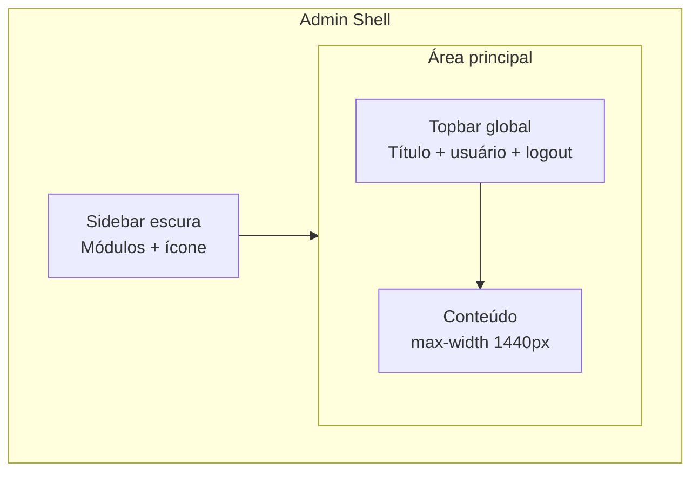

# Painel Admin — Referência Visual e Premissas de UI

Documento de referência para o frontend **connect-adm**. Objetivo: manter consistência visual, acelerar novas telas e preparar o console para crescer como **grande sistema de gestão** sem fragmentação de estilo.

**Escopo:** painel administrativo interno (`localhost:5173`)  
**Stack UI:** React + Vite, CSS vanilla, Lucide React  
**Arquivos-base:** [`src/index.css`](../src/index.css), [`src/layout/AdminLayout.css`](../src/layout/AdminLayout.css)

---

## 1. Premissas visuais (princípios)

### 1.1 Posicionamento

O connect-adm é um **console operacional enterprise**: denso o suficiente para gestão diária, claro o suficiente para uso prolongado. Não é marketing site nem app consumer.

| Princípio | O que significa na prática |
|-----------|----------------------------|
| **Clareza operacional** | Títulos diretos, ações primárias evidentes, dados tabulares legíveis. |
| **Hierarquia modular** | Sidebar = módulos; ao selecionar um módulo, os itens aparecem logo abaixo na mesma coluna; conteúdo = tarefa atual. |
| **Consistência antes de criatividade** | Reutilizar componentes e classes existentes antes de inventar layout novo. |
| **Escalabilidade** | Padrões que funcionam com 5 ou 500 telas: tokens, grid, tabelas, formulários repetíveis. |
| **Confiança** | Feedback explícito (sucesso/erro/carregando), estados vazios orientados, confirmação em ações destrutivas. |
| **Marca contida** | Laranja como acento de ação/seleção; base neutra profissional (cinzas + branco). |

### 1.2 Tom visual

- **Profissional**, não genérico demais: sidebar escura, superfícies claras, tipografia firme.
- **Denso moderado**: padding generoso em cards, tabelas compactas mas respiráveis.
- **Sem ruído**: evitar múltiplas cores de destaque, gradientes exagerados ou animações desnecessárias.

### 1.3 O que evitar

- Criar estilos inline ou CSS por página sem necessidade.
- Misturar padrões antigos (sidebar fixa por seção) com o modelo modular sem migrar.
- Botões primários em excesso na mesma tela (máx. 1 ação primária dominante por contexto).
- Tabelas sem estado vazio, sem loading ou sem tratamento de erro.
- Ícones decorativos sem função (ícones devem reforçar módulo, status ou ação).

---

## 2. Arquitetura de layout

### 2.1 Shell principal



| Zona | Largura / comportamento | Responsabilidade |
|------|-------------------------|------------------|
| Sidebar | ~260px fixo (desktop); lista rolável | Módulos; ao ativar um módulo, **itens** aparecem indentados abaixo |
| Topbar global | ~64px altura | Contexto da página + conta |
| Conteúdo | `max-width: 1440px`, padding 32px | Formulários, tabelas, dashboards |

**Referência de código:** [`AdminLayout.jsx`](../src/layout/AdminLayout.jsx), [`ModuleSidebar.jsx`](../src/layout/ModuleSidebar.jsx)

### 2.2 Hierarquia de título (dentro do conteúdo)

Use sempre [`PageHeader`](../src/components/PageHeader.jsx) ou o padrão equivalente:

1. **Breadcrumbs** (quando houver navegação interna)
2. **Título da página** (`.page-title` — 1 por tela)
3. **Subtítulo** (`.page-subtitle` — contexto curto)
4. **Ações** alinhadas à direita (botão primário + secundários)

Evite `<h1>` solto sem subtítulo em telas de gestão.

### 2.3 Estrutura de página padrão

```jsx
<div className="page-stack">
  <PageHeader title="..." subtitle="..." actions={...} />
  {/* alertas */}
  {/* filtros em .card.form-grid se necessário */}
  {/* conteúdo principal em .panel ou .card */}
</div>
```

Classe `.page-stack`: grid vertical com gap `1.25rem` — **container padrão de toda página**.

---

## 3. Design tokens

Tokens atuais em `:root` ([`index.css`](../src/index.css)). **Novas telas devem usar variáveis**, não hex solto.

### 3.1 Cores — marca e superfície

| Token | Valor | Uso |
|-------|-------|-----|
| `--orange` | `#e8881c` | Botão primário, tab ativa, links de ação |
| `--orange-dark` | `#c97416` | Hover futuro / estados pressionados |
| `--orange-soft` | `rgba(232,136,28,0.1)` | Fundos de destaque leve |
| `--brand-gradient` | `#f0a035 → #e8881c` | Logo mark, elementos de marca pontuais |
| `--foreground` | `#1c1c1e` | Texto principal |
| `--foreground-secondary` | `#3a3a3c` | Texto de apoio |
| `--text-muted` | `#8e8e93` | Labels, meta, cabeçalhos de tabela |
| `--surface` | `#ffffff` | Cards, painéis, inputs |
| `--surface-muted` | `#f7f7f8` | Fundos alternativos |
| `--border` | `#e5e5ea` | Bordas padrão |
| `--success` | `#16a34a` | Sucesso, status positivo |
| `--error` | `#dc2626` | Erro, ações destrutivas |

### 3.2 Cores — layout (sidebar / app chrome)

| Superfície | Valor | Uso |
|------------|-------|-----|
| Sidebar gradient | `#151821 → #1c2030` | Navegação de módulos |
| App background | `#eef0f4` | Fundo geral atrás do conteúdo |
| Panel border | `#dde1ea` | Bordas de painéis enterprise |
| Módulo ativo (sidebar) | `rgba(232,136,28,0.16)` + barra laranja 3px | Item selecionado |

### 3.3 Tipografia

| Elemento | Tamanho | Peso | Classe / contexto |
|----------|---------|------|-------------------|
| Título de página | 1.75rem | 700 | `.page-title` |
| Subtítulo | 0.9375rem | 400 | `.page-subtitle`, cor muted |
| Título de card/painel | 1.125rem | 600 | `.panel-header h2`, `.card h2` |
| Corpo | 0.9375rem | 400 | body, tabelas |
| Label de formulário | 0.875rem | 600 | `<label>`, `.field-label` |
| Meta / uppercase | 0.6875rem | 600 | cabeçalhos de tabela, `.stat-label` |
| Sidebar módulo | 0.9375rem / 0.75rem | 600 / 400 | nome + descrição |

**Fonte:** `Inter, system-ui, sans-serif` (carregar Inter via CDN/font-face é recomendação futura).

### 3.4 Espaçamento (escala sugerida)

Use múltiplos de **4px**. Valores já presentes no projeto:

| Token lógico | Valor | Exemplos no projeto |
|--------------|-------|---------------------|
| xs | 4px | gaps mínimos |
| sm | 8px | gaps internos compactos |
| md | 12–16px | padding de botões ghost |
| lg | 20px | padding de card |
| xl | 32px | padding do conteúdo principal |
| 2xl | 48px | seções vazias |

### 3.5 Raio e sombra

| Elemento | Border-radius |
|----------|---------------|
| Botões | `0.625rem` (10px) |
| Cards / panels | `0.875rem` – `1rem` |
| Badges / pills | `999px` |
| Inputs | alinhado a botões (~10px) |

Sombras: sutis apenas no chrome (`box-shadow: 0 1px 2px rgba(16,24,40,0.04)` na topbar). Cards **não** devem ter sombra forte por padrão — preferir borda `#dde1ea`.

---

## 4. Componentes e padrões

### 4.1 Botões

| Classe | Quando usar |
|--------|-------------|
| `.btn-primary` | Ação principal da seção (Salvar, Criar, Confirmar) |
| `.btn-primary.btn-sm` | Ação primária em tabela ou linha compacta |
| `.btn-ghost` | Ações secundárias (Cancelar, Voltar, filtros) |
| `.btn-ghost.btn-sm` | Editar linha, ações inline |
| `.btn-ghost.btn-danger` | Excluir / inativar com confirmação |

**Regra:** 1 `.btn-primary` dominante por bloco visual (header ou formulário).

### 4.2 Formulários

| Classe | Uso |
|--------|-----|
| `.form-grid` | Grid responsivo: 2 colunas (tablet/desktop) e 3 colunas (≥ 1200px) |
| `.form-section` | Agrupamento visual de campos (fundo `#fafbfc`, borda, título uppercase) |
| `.form-section-title` | Título da seção dentro do formulário |
| `.form-grid-inner` | Grid interno de uma `.form-section` (mesmas regras de colunas) |
| `.file-upload-field` | Upload com preview + botão ghost; input file oculto |
| `.field-span-2` | Campo largo — ocupa 2 colunas do grid |
| `.field-span-full` / `.form-grid-full` | Bloco de linha inteira (ações, seções, uploads) |
| `.form-actions` | Barra de botões ao final do form (dentro de `.field-span-full`) |
| `.input` | Inputs, selects, textareas padronizados |
| `.checkbox-inline` | Checkbox com label ao lado (não estica na largura do grid) |
| `input[type="checkbox"]` | Tamanho fixo 1rem, accent laranja — nunca `width: 100%` |
| `CrudFieldFilterMenu` | Dropdown **Filtrar** — critérios por campo |
| `CrudActiveFilterChips` | Chips dos filtros ativos (removíveis) |
| `filterDefinitions` | Configuração de filtros por CRUD (`filterUtils.js`) |

**Labels:** sempre visíveis acima do campo (não placeholder como label).

**Validação:** mensagem de erro abaixo do form ou `.alert.alert-error` no topo da página.

### 4.3 Painéis e cards

| Classe | Uso |
|--------|-----|
| `.panel` | Bloco enterprise com header + body (listagens principais) |
| `.panel-header` / `.panel-body` | Cabeçalho com título + meta |
| `.card` | Bloco mais leve (formulários, filtros, métricas) |
| `.stat-grid` + `.stat-panel` | Dashboard — KPIs em grid 4 colunas |
| `.metric-card` | KPI financeiro / resumo |

### 4.4 Tabelas

| Classe | Uso |
|--------|-----|
| `.table-wrap` | Wrapper com scroll horizontal |
| `.data-table` | Tabela padrão |
| `.data-table-enterprise` | Variante com hover em linhas clicáveis |
| `.data-table-row-clickable` | Linha abre detalhe |
| `.table-sub` | Texto secundário abaixo do valor principal |
| `.table-empty` | Estado vazio centralizado |
| `.col-actions` | Coluna de ações alinhada |

**Cabeçalho:** uppercase, muted, fundo `#fafbfc`.

### 4.5 Status e feedback

| Classe | Uso |
|--------|-----|
| `.badge` + `.badge-success/error/warning/muted` | Status compacto em tabela |
| `.status-pill-*` | Status financeiro (pendente, liquidado, vencido) |
| `.alert.alert-success` / `.alert-error` | Banner de feedback pós-ação |
| `.success-text` / `.error-text` | Feedback inline legado |
| `.empty-state` | Lista sem registros |

### 4.6 Ícones

- Biblioteca: **Lucide React** ([`utils/icons.jsx`](../src/utils/icons.jsx))
- Tamanhos: 18px inline, 20–22px em módulos, evitar >24px no conteúdo
- Módulos: ícone dentro de container 32px com fundo sutil na sidebar
- **IconPicker:** usar em cadastros de módulo; não inventar novos sets

---

## 5. Padrões por tipo de tela

### 5.1 Listagem (CRUD index)

**Obrigatório:** usar `CrudListShell` + `useCrudList`.

```
PageHeader + botão "Adicionar" (se .manage)
→ CrudListToolbar (busca + ordenação + filtros extras)
→ tabela com AppLoading / empty state
→ CrudRowActions: Visualizar | Editar | Excluir
→ CrudPagination (10/20/50/100 por página)
```

Referências: [`DepartmentsPage.jsx`](../src/pages/DepartmentsPage.jsx), [`UsersList.jsx`](../src/pages/UsersList.jsx)

### 5.2 Formulário create / edit / view

**Obrigatório:** `useCrudRouter` + `CrudFormActions` / `CrudViewActions`.

| Modo | Query | Ações |
|------|-------|-------|
| Criar | `?new=1` | **Salvar**, Cancelar |
| Editar | `?id=uuid` | **Salvar**, Cancelar, Excluir |
| Visualizar | `?id=uuid&mode=view` | Editar, Voltar |

```
PageHeader com breadcrumbs
→ panel com form-grid
→ CrudAlerts para erro/sucesso
→ AppLoadingPanel enquanto carrega registro
```

Referências: [`JobPositionsPage.jsx`](../src/pages/JobPositionsPage.jsx), [`UserEditScreen.jsx`](../src/pages/UserEditScreen.jsx)

### 5.2.1 Kit CRUD — arquivos

| Arquivo | Função |
|---------|--------|
| `src/crud/useCrudRouter.js` | Navegação list/create/edit/view |
| `src/crud/useCrudList.js` | Busca, sort e paginação client-side |
| `src/components/crud/CrudListShell.jsx` | Composição da listagem |
| `src/components/crud/CrudFormActions.jsx` | Salvar / Cancelar / Excluir |
| `src/components/crud/AppLoading.jsx` | Loading padrão |

### 5.3 Dashboard

```
PageHeader sem ação ou com link contextual
→ stat-grid com 3–4 KPIs
→ painéis secundários com tabelas resumidas
```

Referência: [`DashboardPage.jsx`](../src/pages/DashboardPage.jsx)

### 5.4 Gestão modular / configuração

```
PageHeader + ação "Novo"
→ card de formulário colapsável ou seção dedicada
→ tabela de sub-itens com permissões/configurações inline
→ reload da navegação após alterar módulos
```

Referência: [`ModulesPage.jsx`](../src/pages/ModulesPage.jsx)

### 5.5 Financeiro

- Entradas e saídas com **UI espelhada** ([`CashEntryPage.jsx`](../src/components/CashEntryPage.jsx))
- Valores em BRL com `formatMoney`, datas `dd/mm/aaaa`
- Status com `.status-pill-*`; fluxo de caixa somente leitura agregada

---

## 6. Navegação e permissões

- Sidebar exibe **somente módulos** com ao menos 1 item permitido ao usuário.
- Ao **ativar** um módulo (clique ou rota), a sidebar mostra **somente os itens** desse módulo, indentados logo abaixo do cabeçalho do módulo (sem segunda faixa de navegação em cima do conteúdo).
- Rotas: `/m/:modulo/:item` — ao criar módulo/item, seguir este padrão.
- Ações de escrita: proteger com [`PermissionGate`](../src/components/PermissionGate.jsx) + permissão `.manage`.
- Após alterar módulos: chamar `reloadNavigation()` no [`NavigationContext`](../src/navigation/NavigationContext.jsx).

---

## 7. Responsividade

Breakpoint principal: **960px** (sidebar vira drawer).

| Viewport | Comportamento |
|----------|---------------|
| ≥960px | Sidebar fixa (~260px) + conteúdo fluido |
| <960px | Drawer lateral (mesma árvore módulo → itens); padding reduzido; tabelas com scroll |

Form grids: **2 colunas** (721px+), **3 colunas** (≥ 1200px), **1 coluna** abaixo de **720px** (`.form-grid`).

---

## 8. Acessibilidade (mínimo obrigatório)

- Contraste: texto principal `#1c1c1e` sobre branco; muted apenas para meta, não dados críticos.
- Botões icon-only devem ter `aria-label` ou `title`.
- Breadcrumbs com `aria-label="Navegação"`.
- Foco visível em links e botões (melhoria futura: `:focus-visible` consistente).
- Mensagens de erro associadas visualmente ao formulário (não só cor).

---

## 9. Mapa de consistência — estado atual vs alvo

| Área | Hoje | Alvo (próximas iterações) |
|------|------|---------------------------|
| Tokens CSS | Parcial em `:root` | Extrair `design-tokens.css` + remover hex soltos |
| Tipografia | Inter declarada, fallback system | Self-host Inter 400/600/700 |
| Page headers | `PageHeader` + `page-header-block` misturados | Padronizar só `PageHeader` |
| Tabelas | 2 estilos (panel/card) | Componente `DataTable` único |
| Formulários | `.input` + campos nativos sem wrapper | Componente `Field` com label/erro |
| Loading | `AppLoading` / `AppLoadingPanel` | Skeleton em tabelas e cards |
| Dark mode | Não | Fora de escopo v1; tokens preparados |
| Sidebar mobile | Básica | Drawer colapsável com overlay |

---

## 10. Checklist para nova tela

Antes de abrir PR de UI no connect-adm:

- [ ] **CRUD:** usa `CrudListShell` + `useCrudRouter` + `CrudFormActions`
- [ ] **Listagem:** busca, ordenação e paginação presentes
- [ ] **Ações:** Visualizar, Editar, Excluir na tabela (quando aplicável)
- [ ] Usa `.page-stack` como container raiz
- [ ] Usa `PageHeader` (ou padrão documentado) com título + subtítulo
- [ ] Ações destrutivas pedem confirmação
- [ ] Loading, empty e error tratados
- [ ] Cores via tokens CSS (`var(--orange)`, etc.)
- [ ] Tabela dentro de `.table-wrap` se >4 colunas
- [ ] Botão primário único por contexto
- [ ] Permissões `.manage` em botões de escrita
- [ ] Rota segue `/m/modulo/item`
- [ ] Textos em português claro e operacional

---

## 11. Referência rápida de classes

```
Layout       .admin-shell, .admin-content, .page-stack
Títulos      .page-title, .page-subtitle, .page-header-block
Botões       .btn-primary, .btn-ghost, .btn-sm, .btn-danger
Form         .form-grid, .form-section, .form-grid-inner, .form-actions, .input, .checkbox-inline, .file-upload-field
Painéis      .panel, .panel-header, .panel-body, .card
Tabelas      .data-table, .data-table-enterprise, .table-empty
Status       .badge-*, .status-pill-*, .alert-*
Dashboard    .stat-grid, .stat-panel, .metric-card
Módulos      .module-sidebar-*
CRUD         .app-loading, .crud-list-toolbar, .crud-pagination-wrap, .table-wrap-responsive, .data-table (100% width), .crud-row-actions
Financeiro   .flow-in, .flow-out, formatMoney (utils)
```

---

## 12. Evolução recomendada do design system

Ordem sugerida para profissionalizar sem reescrever tudo:

1. **Consolidar tokens** em `src/styles/tokens.css` importado por `index.css`
2. **Componentizar** `Button`, `Field`, `DataTable`, `EmptyState`, `Alert`
3. **Migrar** páginas que usam `page-header-block` → `PageHeader`
4. **Skeleton loaders** em listagens de alto tráfego
5. **Documentação viva** — manter este arquivo atualizado quando novos padrões forem criados

---

*Última atualização: novembro/2026 — layout modular (sidebar: módulo expandido com itens na mesma coluna).*
